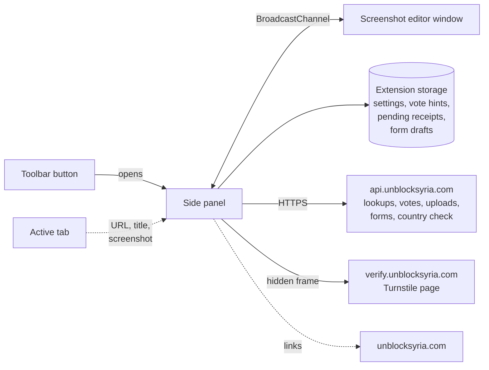
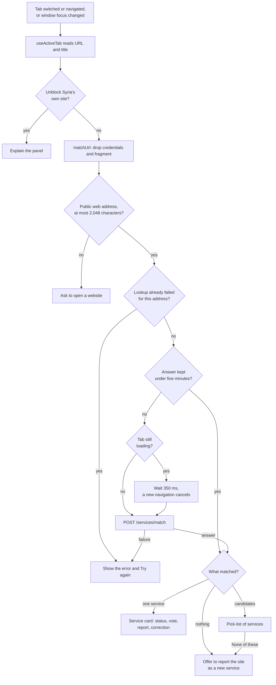
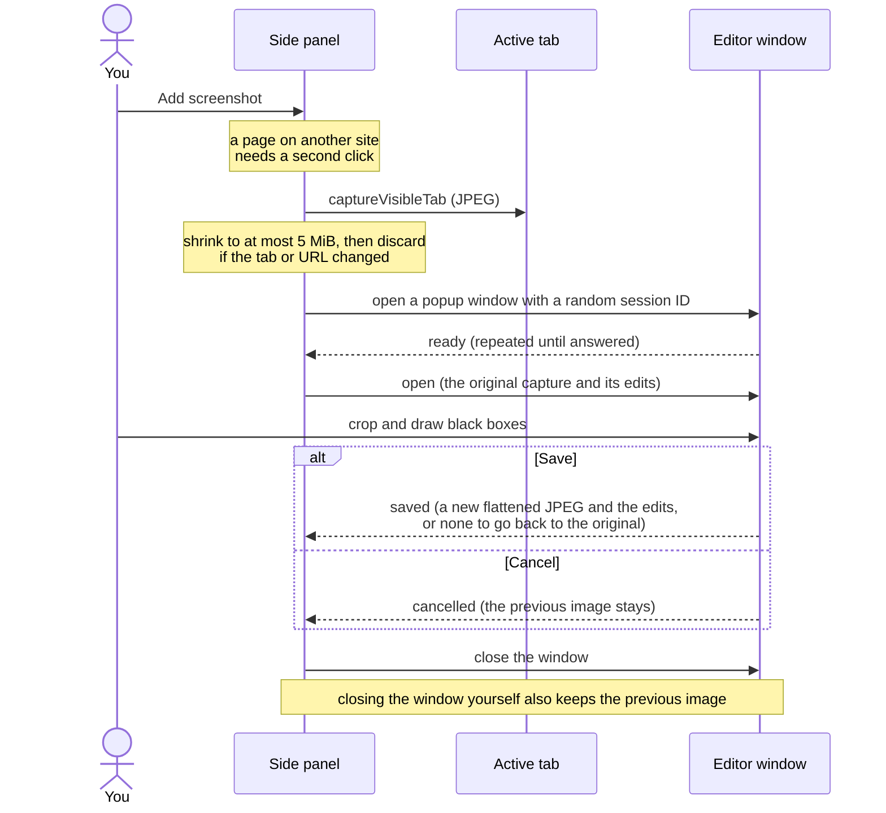
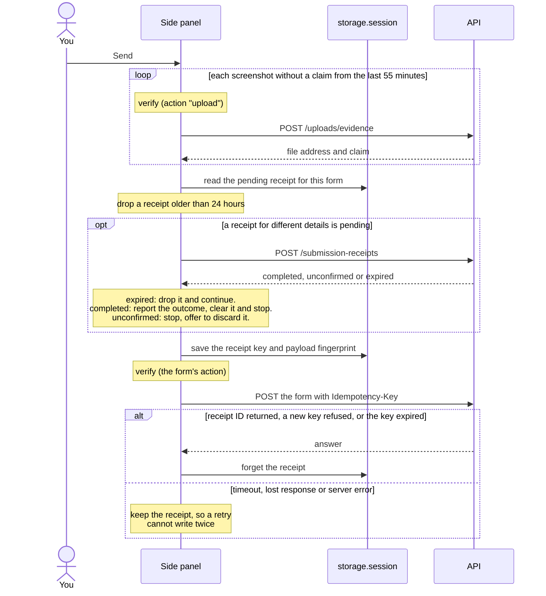

# Architecture

Shaghal is a Manifest V3 extension built with WXT, React and TypeScript, for
Chrome and Firefox. Its side panel (Firefox's sidebar) follows the active tab,
matches it to an Unblock Syria service, and offers votes and moderated
submissions. The extension has no backend or private API key.

## Overview



The extension's work happens in two extension pages: the side panel and the
screenshot editor window. The background worker only makes the toolbar button
open the panel: Chrome's side panel, or Firefox's sidebar. Nothing is injected
into the pages you visit; the one content script runs on Firefox, on the
verification page alone (see [Human verification](#human-verification)).

## Code map

| Location                                                                                                                                                                                             | Responsibility                                                                                                                                                                   |
| ---------------------------------------------------------------------------------------------------------------------------------------------------------------------------------------------------- | -------------------------------------------------------------------------------------------------------------------------------------------------------------------------------- |
| [background.ts](extension/src/entrypoints/background.ts)                                                                                                                                             | Makes the toolbar button open the side panel, or toggle Firefox's sidebar.                                                                                                       |
| [sidepanel](extension/src/entrypoints/sidepanel)                                                                                                                                                     | The panel page. `main.tsx` applies the theme and language before the first paint.                                                                                                |
| [SidePanelApp.tsx](extension/src/entrypoints/sidepanel/SidePanelApp.tsx)                                                                                                                             | Chooses the page card, a form or Settings. Loads a service's full record before opening its report or correction form. Settings opens over the current view.                     |
| [sidepanel/hooks](extension/src/entrypoints/sidepanel/hooks)                                                                                                                                         | Following the active tab, debounced matching, the full record behind the card, and the country check.                                                                            |
| [PageCard.tsx](extension/src/entrypoints/sidepanel/components/PageCard.tsx)                                                                                                                          | What the panel shows for the page: a service card with voting, a pick-list, or an offer to report a new service.                                                                 |
| [sidepanel/components](extension/src/entrypoints/sidepanel/components)                                                                                                                               | The report, correction and new-service forms, the category picker, screenshot thumbnails, the VPN and site-access notices, and what the panel shows on Unblock Syria's own site. |
| [FormParts.tsx](extension/src/entrypoints/sidepanel/components/FormParts.tsx)                                                                                                                        | Shared form controls and the screenshot lifecycle.                                                                                                                               |
| [editor](extension/src/entrypoints/editor)                                                                                                                                                           | The separate screenshot editor window.                                                                                                                                           |
| [ScreenshotEditor.tsx](extension/src/components/editor/ScreenshotEditor.tsx)                                                                                                                         | Crop, black boxes, undo/redo and discard confirmation.                                                                                                                           |
| [components/ui](extension/src/components/ui)                                                                                                                                                         | Buttons, inputs, radio groups and the brand header.                                                                                                                              |
| [api.ts](extension/src/lib/api.ts), [endpoints.ts](extension/src/lib/endpoints.ts)                                                                                                                   | The API client, and one typed, validated function per route.                                                                                                                     |
| [submit.ts](extension/src/lib/submit.ts), [receipts.ts](extension/src/lib/receipts.ts)                                                                                                               | Form submissions and their receipts.                                                                                                                                             |
| [turnstile.ts](extension/src/lib/turnstile.ts)                                                                                                                                                       | Human verification through the verification page.                                                                                                                                |
| [verify-relay.content.ts](extension/src/entrypoints/verify-relay.content.ts), [verifyRelay.ts](extension/src/lib/verifyRelay.ts)                                                                     | Firefox only: the content script that relays the verification page's messages to the panel, and the checks the panel applies to them.                                            |
| [useHostAccess.ts](extension/src/entrypoints/sidepanel/hooks/useHostAccess.ts)                                                                                                                       | Notices when access to websites has been withdrawn, and asks for it again.                                                                                                       |
| [url.ts](extension/src/lib/url.ts), [geo.ts](extension/src/lib/geo.ts)                                                                                                                               | Which page addresses are looked up, and the country check.                                                                                                                       |
| [evidence.ts](extension/src/lib/evidence.ts), [editorWindow.ts](extension/src/lib/editorWindow.ts), [imageEdits.ts](extension/src/lib/imageEdits.ts), [imageBake.ts](extension/src/lib/imageBake.ts) | Capture, resizing and upload; the editor window's messages; crop and box geometry; drawing edits into a new JPEG.                                                                |
| [settings.ts](extension/src/lib/settings.ts), [votes.ts](extension/src/lib/votes.ts), [theme.ts](extension/src/lib/theme.ts), [i18n.ts](extension/src/lib/i18n.ts)                                   | Saved email and language, vote hints, the theme, and the active language and direction.                                                                                          |
| [drafts.ts](extension/src/lib/drafts.ts), [useDraft.ts](extension/src/entrypoints/sidepanel/hooks/useDraft.ts)                                                                                       | Saving a half finished form, screenshots included, to session storage and putting it back when the panel reopens.                                                                |
| [locales](extension/src/locales)                                                                                                                                                                     | English, Arabic and Kurdish panel text. The store name and description are in [public/\_locales](extension/public/_locales).                                                     |
| [theme.css](extension/src/styles/theme.css)                                                                                                                                                          | Shared styles, light/dark tokens, the type scale and the bundled fonts.                                                                                                          |
| [testing](extension/src/testing)                                                                                                                                                                     | Unit test helpers: a fake API that refuses real hosts, JSON fixtures, and `openPanel`, which mounts the panel on a fake tab.                                                     |
| [e2e](extension/e2e)                                                                                                                                                                                 | Browser tests of the production bundle, with external requests stubbed.                                                                                                          |

There are no content scripts on the pages you visit, no injected page scripts,
external messaging handlers, or background polling. Page content cannot invoke
votes, uploads or captures through an extension message API: the only runtime
message the panel handles is the Firefox relay, and it takes that only from the
frame it opened itself. React renders API text without raw HTML.

## Following the page



[useActiveTab](extension/src/entrypoints/sidepanel/hooks/useActiveTab.ts) re-reads
the active tab on every switch, navigation and focus change, and ignores
out-of-order answers. [useServiceMatch](extension/src/entrypoints/sidepanel/hooks/useServiceMatch.ts)
does the lookup. A new navigation aborts the pending request, although the server
may already be handling it.

[matchUrl](extension/src/lib/url.ts) skips non-web pages, IP addresses,
single-label hosts, common local domains, and addresses longer than the API's
2,048-character limit. It keeps the path and query, which some services need for
matching. Sending the address in a POST body keeps it out of URL logs, but the
query can still hold private data.

A loaded page, a tab switch or a reopened panel is looked up at once; only a
tab that is still loading waits 350 ms, so a redirect chain costs one lookup.

The panel never polls: an unchanged page is not looked up again, and a failed one
waits for Try again. **None of these** and the new-service offer open a form
prefilled with the site's scheme and host (without `www.`) and the tab title.

A parent-domain match or a service picked from the list or the search carries
a way off the card: **Not this?** opens the search, and **Back to the list**
returns to the pick without a new lookup.

### Kept answers

[cache.ts](extension/src/lib/cache.ts) and [reads.ts](extension/src/lib/reads.ts)
keep each successful read, so the panel asks for it once. Concurrent asks share
one request. Answers live in memory and in `chrome.storage.session`, which is also
held in memory and emptied when the browser closes, so a closed and reopened
panel starts warm without anything reaching the disk.

| Answer                         | Used as is | Shown while asking again | At most     |
| ------------------------------ | ---------- | ------------------------ | ----------- |
| Page lookups, by address       | 5 minutes  | 30 minutes               | 50 pages    |
| Service records, by language   | 5 minutes  | 30 minutes               | 20 records  |
| Parts and categories catalogue | 1 hour     | 24 hours                 | 3 languages |
| Services to check              | 10 minutes | 1 hour                   | 6 lists     |
| Country check                  | 10 minutes | 10 minutes               | 1           |

The card loads the full record as soon as it matches a service, so the report
and correction forms open with it at once. Pointing at **Report what works**
starts loading the parts catalogue. At startup the panel also opens connections
to the API and the verification host ([preconnect.ts](extension/src/lib/preconnect.ts)),
which saves the DNS and TLS round trips on the first request.

## API boundary

[api.ts](extension/src/lib/api.ts) sends each request once, with a 60-second network
timeout that starts after verification. It omits cookies and referrers, rejects
redirects, and returns a typed success/error result. Read and vote responses are
validated before UI code uses them; form submissions require a receipt ID.
Malformed responses become errors. A timeout or lost response can leave a write's
outcome uncertain.

An error without a usable API message shows a translated
notice with its status code. Visible API errors include the server's request
reference when present, including vote notices, form cooldowns and upload errors.
The reference is ordinary selectable text so it can be copied into a bug report.

| Route                                                          | Used for                                                     |
| -------------------------------------------------------------- | ------------------------------------------------------------ |
| `POST /services/match`                                         | Matching the page to a service.                              |
| `GET /services?search=name`                                    | The untracked card's search by service name.                 |
| `GET /services?needs_retesting=true` / `?availability=unknown` | The "help check these" list, most voted first.               |
| `GET /services/:slug`                                          | The full record behind the card and the forms.               |
| `GET /check-duplicate?url=`                                    | Whether a new service was already sent.                      |
| `GET /functionalities`, `GET /categories`                      | Part and category names for the report and correction forms. |
| `POST`, `DELETE /services/:slug/vote`                          | Casting or removing a vote. Verified.                        |
| `POST /uploads/evidence`                                       | Uploading one screenshot. Verified.                          |
| `POST /functionality-reports`, `/corrections`, `/submissions`  | Sending a form. Verified, with an `Idempotency-Key`.         |
| `POST /submission-receipts`                                    | Asking what happened to an earlier, unconfirmed send.        |

[receipts.ts](extension/src/lib/receipts.ts) protects form sends from being
written twice. Each send gets a random key, stored in session storage with a hash
of the request body. There is one pending receipt per service for reports and
corrections, and one per submitted address for new-service submissions. Resending the same
body reuses the key, and the API answers a repeated key with the original result.
A different body first asks `POST /submission-receipts` what happened to the
earlier send; the sequence is in [Forms and screenshots](#forms-and-screenshots).
A receipt the API no longer knows (it answers `expired`, or the key is over 24
hours old) is dropped. One it can't confirm blocks new details until you resend
the originals or choose **Discard earlier attempt**. The panel never resends on
its own, and won't send at all if session storage is unavailable.

On a 429, forms show how long to wait, read from `Retry-After` (seconds or an
HTTP date). Client-side validation only saves wasted requests; it is not an
anti-abuse measure.

| Build       | API                            | Site links                 | Verification                      |
| ----------- | ------------------------------ | -------------------------- | --------------------------------- |
| Development | `http://localhost:8787`        | `http://localhost:3000`    | `http://localhost:8790`           |
| Production  | `https://api.unblocksyria.com` | `https://unblocksyria.com` | `https://verify.unblocksyria.com` |

`WXT_API_BASE`, `WXT_SITE_BASE` and `WXT_VERIFY_BASE` override these at build time.
Any build whose API is on `localhost` or `127.0.0.1` skips client verification.

The country check bypasses the API client: [geo.ts](extension/src/lib/geo.ts)
fetches `https://api.unblocksyria.com/cdn-cgi/trace` in every build, with a
10-second timeout. It drives the notice on the card and the VPN warning in the
report and new-service forms: review records a test only when it comes from a
Syrian network, so a tester elsewhere hears it before writing one. The answer is
kept for ten minutes and shared by every view.

## Human verification

[turnstile.ts](extension/src/lib/turnstile.ts) frames
`/extension/turnstile?action=<action>&nonce=<uuid>` on the verification host.
The page returns an `unblocksyria-turnstile` message with the nonce, action and
status: `interactive`, `solved` with a `token`, or `error` with a `code`.

```mermaid
sequenceDiagram
    participant P as Side panel
    participant V as verify.unblocksyria.com
    participant A as API
    P->>V: hidden frame with the action and a random nonce
    alt Turnstile needs a click
        V-->>P: interactive
        Note over P: shows the frame under the button<br/>that asked (Cancel or Escape stops)
    end
    V-->>P: solved, with a token (to the extension's origin only;<br/>on Firefox, through the content script)
    Note over P: checks origin, frame, nonce and action,<br/>then removes the frame
    P->>A: request with X-Turnstile-Token
    A-->>P: result (the API validates the token)
```

Every write needs its own token: each vote change, each screenshot upload and the
form itself. Builds with a loopback API skip verification.

The frame is created where it will be shown, since moving a frame reloads it.
The vote button and each form's send button sit in a
[VerificationSlot](extension/src/entrypoints/sidepanel/components/VerificationSlot.tsx);
the frame lies invisible over the newest visible slot, still on screen so the
challenge runs at full speed, and joins the layout under the button only when a
click is needed. With no slot on screen, it shows in a dialog over the panel.

Tokens are fetched ahead where the next request is known: when the pointer
reaches the vote or send button, and while one screenshot uploads, for the next
upload or the form. A token fetched ahead keeps any click it needs hidden until
the request claims it, and is replaced once it is four minutes old.

The panel accepts messages only from its own frame, from the exact verification
origin, with the expected nonce and action. It ignores a token that is blank or
longer than 2,048 characters. The page has 30 seconds to load and an interactive
challenge two minutes; repeated messages don't extend either deadline.

In Chrome the page posts its messages to the extension's origin, which the
manifest key fixes and the page's `frame-ancestors` names. Firefox gives an
add-on a random origin per install, so the page can't post to it. There, the
page dispatches each message as a DOM event, and
[verify-relay.content.ts](extension/src/entrypoints/verify-relay.content.ts), a
content script registered for the verification page only, in every frame, at
`document_start`, sends it to the panel with `runtime.sendMessage`. The panel
takes a relayed message only when the sender's address is the exact frame it
opened: the verification origin and path with its own nonce and action
([verifyRelay.ts](extension/src/lib/verifyRelay.ts)). Every content script on
that page can hear the event, so what decides who can read a token there is
host permission for the verification page, the same access an extension already
needs to read the token out of the widget.

The client checks don't replace
[server validation](https://developers.cloudflare.com/turnstile/get-started/server-side-validation/)
of the token, action and hostname. Tokens are single-use and expire after five
minutes. The manifest key and extension ID identify the client, but they are not
credentials, and the Firefox add-on has no equivalent.

## Forms and screenshots

### Votes

[votes.ts](extension/src/lib/votes.ts) keeps a local hint of which services this
browser voted for. The API is the source of truth: `ALREADY_VOTED` and
`NO_VOTE_FOUND` answers correct the hint, and a failure to save the hint never
turns an accepted vote into an error. The button shows the new state and count
at once, and a refusal puts both back with the reason. Removing a vote takes a
second click within three seconds. Services marked Available can't be voted for;
Usable ones can.

### Forms

- A report starts with nothing chosen, or with the part whose **Test this** or
  **Still fails?** opened it. It sends only the parts the tester chose and
  answered, each with a note or a screenshot, as the API requires. It can have
  up to 30 parts and 100 screenshots, five per part. A part the tester names
  goes as `proposedName`, never as a slug; the catalogue's catch-all part is not
  offered. Parts that count as failing once sign-in fails need no answer of
  their own. An optional connection type goes as `submitterNote`.
- After a confirmed send, [history.ts](extension/src/lib/history.ts) records the
  service, the parts and their levels in local storage (no notes, screenshots or
  email), so the card can mark parts reported in the last 30 days and Settings
  can list what was sent. Settings clears it.
- A report also sends `testedHost`, the host of the page the form was opened on,
  lowercased and without `www.` ([`testedHostOf`](extension/src/lib/url.ts)). One
  service can span hosts that behave differently from Syria, so reviewers need to
  know which one was tested. The form shows the host, and leaves the field out
  for a page that is not a public web address. The report draft stores the host,
  so a report reopened on another address keeps the one its evidence came from;
  a draft without a stored host sends none.
- A correction sends all changed fields in one submission. Categories go as a
  JSON array of up to ten IDs.
- A new service needs a name (up to 200 characters); the description is capped at
  2,000 and opens with what happens from Syria when the tester picks it. The form
  checks `GET /check-duplicate` once and says when the site is already waiting
  for review; it never blocks the send.
- Corrections and new services are verified by their screenshots, so a send
  without one asks once: add a screenshot, or send anyway.
- Corrections and new services take up to ten screenshots.

### Screenshots

Screenshots and their edit history stay in memory. While a form is half
finished, that memory includes session storage: each draft carries the raw bytes
of its screenshots so the panel can close and reopen, and the record is deleted
on a successful send, when the tester confirms the discard dialog, or when the
browser restarts. Nothing is ever written to disk.

1. **Capture.** In the report and new-service forms, a page on a different site
   from the form's needs a second click. A capture over 600 KB is redrawn as a
   JPEG at most 2048 pixels on its longest side, usually a third of the bytes,
   which matters on a slow upload; it is also resized to fit the API's 5 MiB
   limit, and dropped if the tab or its URL changed meanwhile. A picked, dropped
   or pasted image keeps its own bytes.
2. **Edit.** A popup window opens the editor over a `BroadcastChannel` with a
   random session ID. Only one editor is open at a time. If the window can't be
   created, the editor opens inside the panel instead.
3. **Save.** The crop and black boxes are drawn onto the original capture as a
   new JPEG, resized again if needed. The original stays for later edits; only
   the rendered image is uploaded.
4. **Send.** Each screenshot is verified and uploaded in turn, then the form is
   verified and sent. Sending waits for any capture or open editor, and the
   form is disabled while it sends.
5. **Retry.** An upload's claim is reused for 55 minutes, inside the API's one-hour
   expiry. Editing a screenshot invalidates its claim. A failed send doesn't
   delete uploads already made.

Capture and edit (steps 1 to 3):



Send and retry (steps 4 and 5):



An upload's claim is what lets a submission attach it. The API expires uploads
that are never attached, but until then one may be readable at its address.
Attached screenshots stay readable by anyone with the address, and the extension
can't delete an upload.

A half finished form is written to session storage about half a second after the
tester stops typing, and put back when the panel reopens on the same service, so
closing the panel no longer costs the report. Back asks before discarding
changes, and Settings opens over the form without unmounting it. The record is
deleted when the send succeeds or the discard is confirmed, and the browser drops
it on restart. The unload warning is best effort, so the last half second of
typing can still be lost.

## Language and theme

[i18n.ts](extension/src/lib/i18n.ts) sets up i18next with the catalogs in
[locales](extension/src/locales). `en.ts` defines every key. `ar.ts` adds Arabic
plural forms, `ku.ts` is Kurdish (Kurmanji, in Latin script), and any key a catalog
leaves out falls back to English. The `system` choice follows the browser's
language. The active language sets `lang` and `dir` on the page (only Arabic runs
right to left), the `/en`, `/ar` or `/ku` path of site links, and the `locale` sent
to the API. Dates are written as the website writes them, with its month names:
"1 Sep, 2026", the Levantine "1 أيلول، 2026" in Arabic, and the site's Kurdish
abbreviations. Counts and country names use the language's `Intl` formats; Kurdish
uses en-GB ones in a browser without Kurdish locale data.

[theme.ts](extension/src/lib/theme.ts) stores the System, Light or Dark choice and
sets `data-theme` on the page; [theme.css](extension/src/styles/theme.css) resolves
its colors with `light-dark()`. The editor window is always dark.

The panel uses the website's typefaces, shipped in
[public/fonts](extension/public/fonts): Basis Grotesque Pro for Latin text and ITF
Qomra Arabic for Arabic, where it also sets Latin names and figures, as the site
does. Every size comes from the type scale in theme.css, every weight is regular
or medium, and spacing follows a 4px grid.

## Accessibility

The panel is checked against WCAG 2.2 AA in English and in right-to-left Arabic,
by axe in [a11y.spec.ts](extension/e2e/a11y.spec.ts) and by these conventions:

- **Focus.** Each view's heading takes focus as it opens, and a closed view hands
  focus back to what opened it. Every control shows the gold focus ring, which
  clears 3:1, and a field keeps an outline that forced colours can draw.
- **State without colour.** A chosen chip leads with a check, an active switch has
  an edge, and field borders reach 3:1. Under forced colours, such as Windows High
  Contrast, chosen controls take the system's selection colours.
- **Blocked sends.** A Send button that can't send yet stays in the tab order with
  `aria-disabled`, and the line under it, which says why, describes it.
- **Errors.** An invalid email is shown under its field, which it marks invalid and
  describes, and the tester is taken back to it.
- **Structure.** The header is a landmark, rows of services are lists, links that
  open a tab say so to screen readers, and decorative logos and icons are hidden
  from them.
- **Language.** Notes take the direction of what is typed, addresses read left to
  right, and the language setting offers each language under its own name.
- **Motion and zoom.** With reduced motion nothing fades, slides or spins, and the
  panel reflows without sideways scrolling at 200% zoom.

## Permissions and storage

| Permission   | Why                                                                                                                                       |
| ------------ | ----------------------------------------------------------------------------------------------------------------------------------------- |
| `tabs`       | Read the active tab's URL and title.                                                                                                      |
| `sidePanel`  | Show the panel. Chrome only; Firefox's `sidebar_action` needs no permission.                                                              |
| `storage`    | Keep settings, vote hints, pending receipts and half finished form drafts.                                                                |
| `<all_urls>` | Capture screenshots of any site the panel follows, reach the API (or a local one), and on Firefox run the relay on the verification page. |

`activeTab` would be narrower, but its grant ends on navigation, so every new page
would need another toolbar click; see
[Chrome's permission model](https://developer.chrome.com/docs/extensions/develop/concepts/activeTab).
Firefox lets you withdraw access to websites in the add-on's settings, and
Chrome's site-access menu can withhold it. The panel then can't look up a page or
send anything, so it shows a notice with a button that asks for the access again.

| Store                    | Keys                                                                          | Lifetime                                            |
| ------------------------ | ----------------------------------------------------------------------------- | --------------------------------------------------- |
| `chrome.storage.local`   | `testerEmail`, `language`, `voteHint:<slug>` (and legacy `votedServiceSlugs`) | Until cleared                                       |
| `chrome.storage.session` | `pendingReceipt:<path>:<target>`, `draft:<form>:<serviceKey>`                 | Until the browser restarts or the extension reloads |
| `localStorage`           | `theme`                                                                       | Until cleared                                       |

The saved email changes only after a successful submission with an email, or in
Settings, where saving it blank clears it. Vote hints are separate keys, so panels
update each other through storage events without overwriting each other. No
browsing history is stored, and a screenshot is written only as part of the draft
described above. Service logos load from the hosts the API supplies, without a
referrer.

Chrome 123 is the minimum, for CSS `light-dark()`. Other Chromium browsers need
the same side panel API and aren't tested. Firefox 140 is the minimum, for the
data-collection notice addons.mozilla.org requires of new listings; the add-on's
ID there is `shaghal@unblocksyria.com`.

## Abuse boundaries

Anyone can call the public API directly, from a modified extension or a script.
CORS, the extension ID, disabled buttons and vote hints don't prevent that, so the
server enforces verification, quotas, vote uniqueness, upload checks and
moderation for every client. The extension holds no credential that bypasses them.

## Validation

`npm run check` runs ESLint on `src`, Prettier on the extension and the Markdown
files at the root, TypeScript, Vitest, a production build for each browser, and
Mozilla's `addons-linter` on the Firefox one.
`npm run test:e2e` loads the last Chrome build into Chromium. Unit tests fail on
any unstubbed fetch; browser tests stub every HTTP(S) request, including the
verification page, and fail on unknown ones. Neither suite writes to the live
service.

The browser tests open the panel as a tab, not a native side panel, and run in
Chromium only. Real Turnstile challenges, the live API, Firefox and
assistive-technology checks are not covered.
